# Mobile Repair POS


## 📌 Project Overview
Mobile Repair POS is a modern, full-stack Point of Sale and store management system built specifically for mobile and electronics repair shops. It streamlines repair tracking, inventory management, point-of-sale transactions, and customer relationships, all within a responsive web application.

---

## 📞 Contact Details
- **Company Name:** [Your Company Name]
- **Email:** [contact@yourcompany.com]
- **Phone:** [+1-234-567-8900]
- **Website:** [www.yourcompany.com]

## 🌐 Social Media Links
- [Twitter / X](https://twitter.com/yourcompany)
- [LinkedIn](https://linkedin.com/company/yourcompany)
- [Facebook](https://facebook.com/yourcompany)
- [Instagram](https://instagram.com/yourcompany)

---

## ✨ Key Features
- **User Authentication & Authorization:** Secure login with JWT.
- **Repair Tracking System:** Create, manage, and update the status of repair tickets.
- **Point of Sale (POS):** Process sales and repairs efficiently.
- **Customer Management:** Maintain records of clients and their device history.
- **Responsive Dashboard:** Real-time metrics and modern UI accessible on any device.

---

## 🛠 Technology Stack (v0.1.0)
- **Framework:** [Next.js v16.3.0](https://nextjs.org/) (React v19.2.8)
- **Styling:** [Tailwind CSS v4](https://tailwindcss.com/)
- **Icons:** [Lucide React v1.38.0](https://lucide.dev/)
- **Database:** [MongoDB](https://www.mongodb.com/) & [Mongoose v9.9.2](https://mongoosejs.com/)
- **Authentication:** [JSON Web Tokens (JWT) v9.0.3](https://jwt.io/) & bcryptjs v3.0.3

---

## 📋 Requirements & Prerequisites
- **Node.js:** v18.0.0 or higher
- **npm / yarn:** Package manager
- **MongoDB:** A local MongoDB instance or a MongoDB Atlas cluster.

---

## ⚙️ Installation Instructions
1. Clone the repository:
   ```bash
   git clone https://github.com/yourusername/MobileRepairPos.git
   cd MobileRepairPos
   ```
2. Install the dependencies:
   ```bash
   npm install
   ```

---

## 🔧 Configuration Steps
Create a `.env.local` file in the root directory and add the following environment variables:
```env
MONGODB_URI=your_mongodb_connection_string
JWT_SECRET=your_jwt_secret_key
```

---

## 🗄 Database Setup
1. Ensure your MongoDB service is running locally, or you have your MongoDB Atlas connection string ready.
2. The application will automatically connect to the database via Mongoose using the `MONGODB_URI` specified in your `.env.local` file when you start the server.

---

## 🚀 How to Use
1. Start the development server:
   ```bash
   npm run dev
   ```
2. Open your browser and navigate to `http://localhost:3000`.
3. Use the demo credentials (if provided below) or register a new account to explore the dashboard.

---

## 📦 Optional Modules
- **SMS Notifications:** (Placeholder) Integration for sending repair updates via SMS.
- **Email Receipts:** (Placeholder) Send digital invoices to customers.

---

## 📁 Project Structure
```text
MobileRepairPos/
├── public/              # Static assets (images, logos, screenshots)
├── src/                 # Application source code
│   ├── app/             # Next.js App Router (pages and layouts)
│   ├── components/      # Reusable React components
│   ├── lib/             # Utility functions and database connections
│   └── models/          # Mongoose database schemas
├── .env.local           # Environment variables (git-ignored)
├── package.json         # Project dependencies and scripts
└── README.md            # Project documentation
```

---

## 🖼 Screenshots

### Dashboard
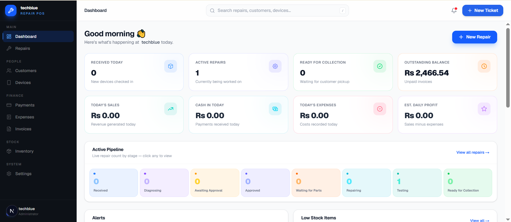

### Repairs List
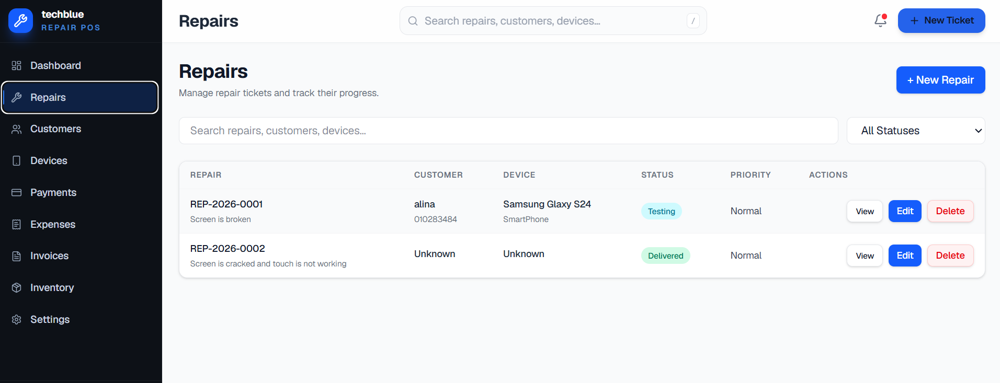

### Repair Form
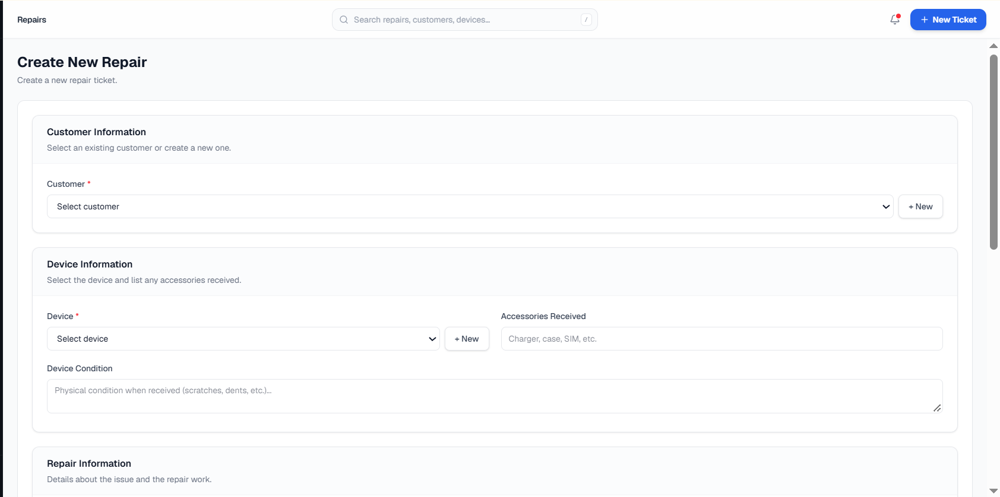

### Repair Timeline
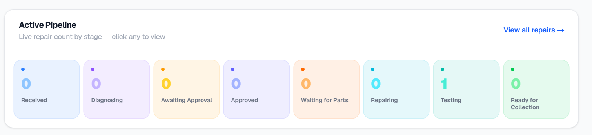

### Inventory & Parts
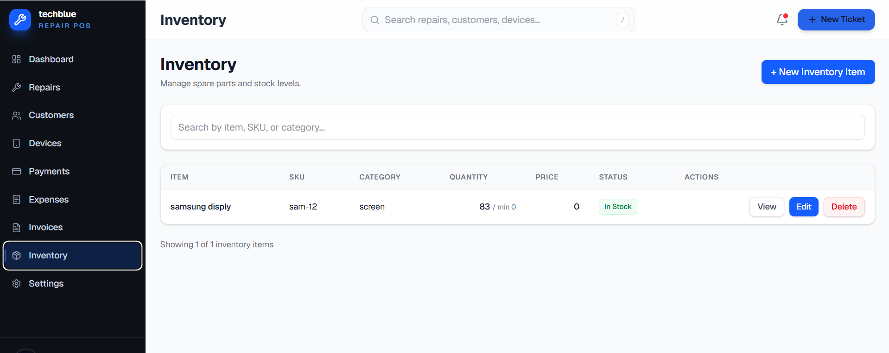

### Customer Management
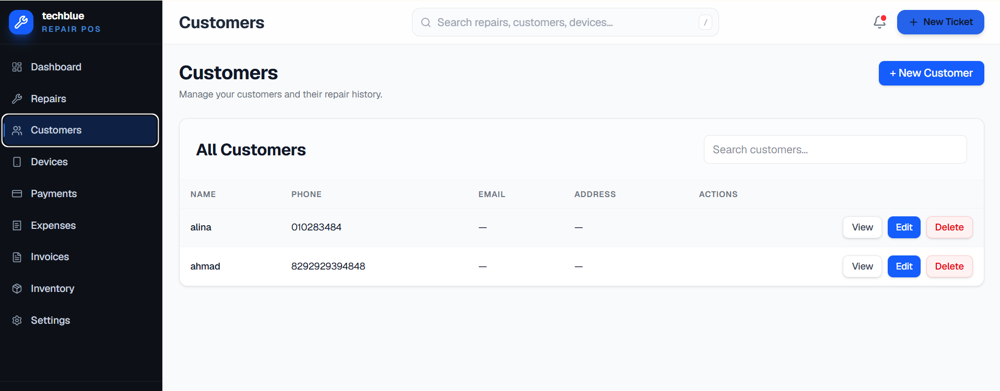

### Sales & Invoicing
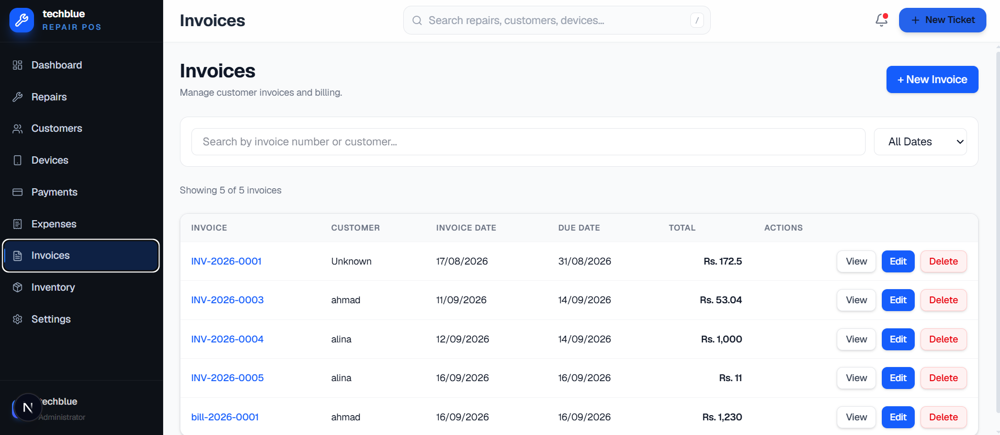

### Payments
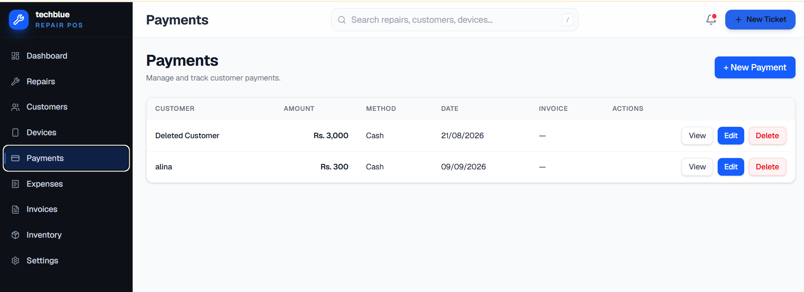

### Expenses
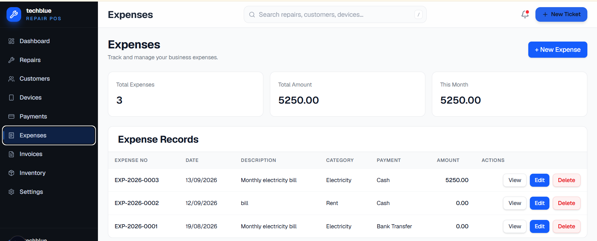

### Devices
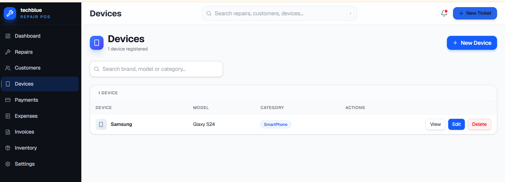

### Settings
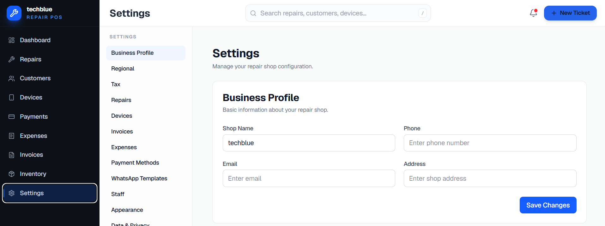

---

## 🌍 Live Demo
**Link:** [https://mobile-repair-pos.vercel.app/](https://mobile-repair-pos.vercel.app/)

---

## 📚 Documentation
**Link:** [https://mobile-repair-doc.sumsols.com/](https://mobile-repair-doc.sumsols.com/)

---

## 🔑 Demo Credentials
- **Role:** Admin
- **Email:** admin@demo.com
- **Password:** admin123

---

## ❓ Frequently Asked Questions (FAQ)

**Q: Is this system suitable for multi-store setups?**
A: Currently, this MVP is optimized for a single-store setup, but it can be extended.

**Q: Can I use a different database like PostgreSQL?**
A: The project heavily uses Mongoose. Switching to PostgreSQL would require rewriting the database models (e.g., using Prisma).

---

## ☁️ Deployment Instructions
The easiest way to deploy this Next.js app is via [Vercel](https://vercel.com/):
1. Push your code to a GitHub repository.
2. Go to Vercel and import the repository.
3. Add the environment variables (`MONGODB_URI`, `JWT_SECRET`) in the Vercel dashboard.
4. Click **Deploy**.

---

## 📄 License
This project is licensed under the MIT License - see the [LICENSE](LICENSE) file for details.

---

## 📱 App Links & Socials
- **Web App Link:** [Mobile Repair POS Live](https://mobile-repair-pos.vercel.app/)
- **Android App:** [Coming Soon](#)
- **iOS App:** [Coming Soon](#)
- **Support Group:** [Telegram/Discord Link](#)
